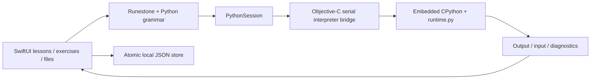

# PyLearn for iPhone

## Intent and agreed constraints

Build an offline Chinese Python learning app using Runestone. Target iOS 16.3 or later and produce an arm64 IPA for installation with TrollStore. The user authorized implementation and selected Runestone. The requested GitHub owner is `wjc0104`; both connected GitHub and CLI were still `wm0104` when checked, so do not create or push a repository under that account.

## First release

- Eight short lessons with runnable examples and two exercises each.
- Runestone editor with Python highlighting, line numbers, undo/redo, indentation and a symbol toolbar.
- Syntax checking, error line selection and Chinese explanations for common errors.
- Basic keyword, built-in name and local-name completion, without evaluating user code.
- Background, single-file CPython execution with console output, interactive input and cooperative stop.
- Import UTF-8 `.py` files from Files, retain a local copy, auto-save, export and delete with confirmation.
- Local progress and scripts only. No account, backend, ads, analytics, AI, arbitrary package manager or multi-file project system.

## Architecture decision

Use a small native SwiftUI application. Runestone provides editing and TreeSitterPythonRunestone provides the grammar. BeeWare's pinned CPython 3.13 iOS XCFramework provides execution. An Objective-C C-API bridge owns the interpreter on one serial queue; Python helpers implement diagnostics and execution. SwiftUI receives output on the main queue. A condition variable supports input and cancellation while waiting.

The interpreter is embedded in the app process, not an OS security boundary. Normal Python loops and the provided sleep/input helpers support cooperative cancellation; arbitrary blocking C extension calls cannot be forcibly killed safely. Do not request private entitlements, root access, JIT or unsandboxing. Scripts should be trusted by their owner.

## Defaults selected by the developer

Working name: PyLearn (Python 学习). Bundle identifier: `com.wjc0104.pylearn`. Dark/light system appearance with a readable monospaced editor. Maximum imported source: 512 KiB. Maximum console output: 20,000 characters. Default execution limit: 10 seconds excluding waiting for input. Each run uses a fresh globals dictionary. Files are stored by UUID with atomic writes; failed reads must not overwrite existing data.

## Delivery and verification

Windows can test the portable Python helpers and IPA inspector. macOS/Xcode is required to compile Swift/Objective-C and run simulator tests. A GitHub workflow will prepare pinned dependencies, run tests, build arm64, ad-hoc sign embedded frameworks and the app, zip `Payload/PyLearn.app`, and inspect the resulting IPA. Verify minimum iOS version, architecture, framework deployment targets, ZIP integrity and SHA256 separately from physical iPhone/TrollStore installation.

## Components

